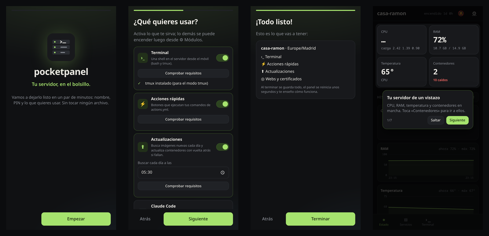

# pocketpanel

Your home server in your pocket: a small, self-hosted phone app (PWA) to keep an eye on a Linux + Docker
server and fix things from the couch. Lightweight (FastAPI + vanilla JS, one container), private by default
(listens only on `127.0.0.1`, meant to be reached over [Tailscale](https://tailscale.com)) and modular: turn on
only what you use.

> 🇪🇸 La interfaz está en español. [Instrucciones en español más abajo](#en-español).

<p align="center">
  
</p>

<p align="center">
  <a href="docs/screenshots/trailer.mp4"></a><br>
  <sub>▶ <a href="docs/screenshots/trailer.mp4">Watch the 30-second trailer</a> · screenshots use demo data</sub>
</p>

## Features

Always on:

- **Status**: CPU, RAM, temperature, disks, uptime and 1 h / 24 h / 7 d history charts.
- **Containers**: list, start / stop / restart, live logs, open button for each web UI.
- **Push alerts** (Web Push): a container stops, a disk fills up, a module reports a problem.
- PIN login with rate limiting, installable as an app on Android / iOS.

Optional modules, turned on and configured from the app itself (**Status → ⚙ Modules**):

| Module | What it does | Needs on the host |
|---|---|---|
| `terminal` (on) | Full terminal (bash, tmux) on the host over SSH, several sessions in tabs | `tmux` for tmux mode |
| `actions` (on) | One-tap buttons that run your own commands (`actions.yml`) | – |
| `updates` (on) | Daily check for newer images, one-tap update with automatic rollback if the new container doesn't come up | – |
| `packages` | System packages (apt) waiting for an update, with security ones and a pending reboot flagged; check and upgrade from Estado. The upgrade runs detached on the host, so it survives the panel restarting (e.g. when Docker itself is upgraded) | passwordless `sudo apt update` and `sudo apt upgrade -y` (`user ALL=(root) NOPASSWD: /usr/bin/apt update, /usr/bin/apt upgrade -y`) |
| `claude` | Chat with [Claude Code](https://claude.com/claude-code) running on the server, attach files, daily health report by push | `claude` installed and logged in |
| `backups` | Nightly incremental backups (rsync + hardlinks) of a folder to another machine over SSH, restore one app's folder from the container sheet | `rsync` on both ends |
| `raid` | mdadm RAID state + SMART (local or on another box over SSH) | `mdadm`, `smartctl` |
| `files` | Lightweight file manager over SFTP (the same SSH connection): browse, multi-select, copy/cut and paste between folders, rename, delete, upload (drag and drop), download (folders as `.tar`), preview images/video/audio/PDF and edit text files. Limited to the folders you list | – |
| `sites` | Checks that your websites answer and how many days their TLS certificate has left; push alert when one goes down, comes back or is about to expire | – |
| `downloads` | qBittorrent (pause/resume, speeds, ETA), Sonarr/Radarr queue and what airs in the next 7 days; push when a download finishes or *arr reports a problem | qBittorrent / Sonarr / Radarr |
| `jellyfin` | Manage Jellyfin accounts and invites through [jfa-go](https://github.com/hrfee/jfa-go) | jfa-go |
| `stocks` | Stock portfolio: prices, rule-based buy/hold/sell verdicts (RSI, MACD, Bollinger, ATR stops, entry zones), watchlist, a "discover" scan of ~50 large caps and Telegram/push alerts when a verdict changes. It only records what you do at your broker | downloads `curl_cffi` (~38 MB) when enabled |

On a wide screen it switches to a sidebar layout:


## Install (Ubuntu / Debian + Docker + Tailscale)

Requirements: Docker with the compose plugin (your user in the `docker` group), `openssh-server`, `python3`.

```sh
git clone https://github.com/dromerCode/pocketpanel.git ~/pocketpanel
cd ~/pocketpanel
./install.sh                 # run as your normal user, not root
```

That's the only command. The installer builds the image, creates an SSH key that the panel uses to reach the
host (restricted to `from="127.0.0.1"`), offers to publish the panel on your tailnet with HTTPS
(`tailscale serve`, needed for the installable app and push notifications) and prints a **QR code**.

Scan it with your phone: it opens a **setup wizard** (server name, time zone, PIN, which modules you want with
their options and a live requirements check, notifications, adding it to your home screen) and finishes with a
short **guided tour**. No files to edit.

<p align="center"></p>

### Configure

Open **Status → ⚙** in the app: a "module store" where you switch modules on and off, fill in their options,
run a requirements check on the server (is `rsync` there? can it SSH into the backup box? is `claude` installed?)
and save. The panel rewrites `config.yml` (keeping your comments) and restarts itself in a couple of seconds.

<p align="center"></p>

You can still edit `config.yml` by hand (every option is commented) and apply with
`docker compose up -d --force-recreate`. Passwords entered in the app (jfa-go) are stored in `data/secrets.json`
(0600), not in `config.yml`. Change the PIN with `./install.sh NEWPIN`. Update with `git pull && ./install.sh`.

### Backups as root (optional)

By default backups and restores run as your user, so files only root can read are skipped (the panel tells
you which ones) and those backups can't be restored. To copy everything:

```sh
sudo ./install-root.sh        # again after changing modules.backups; --remove to undo
```

It copies `backup.sh` / `restore.sh` to `/etc/pocketpanel` (owned by root, source and destination fixed from your
config) and adds a sudoers rule that lets your user run **only those two scripts** as root.

## Without Tailscale

Tailscale is optional. To reach the panel directly on a port of your server, add to `.env`:

```sh
PANEL_BIND=0.0.0.0   # or one IP of the server, e.g. its LAN address
PANEL_PORT=9300
```

and run `docker compose up -d --force-recreate` (answer *n* if `./install.sh` offers `tailscale serve`).
Open `http://<server>:9300`. Over plain HTTP everything works except push notifications and installing it as an
app, which browsers only allow over HTTPS: put it behind your reverse proxy (NPM, Caddy, Traefik…, with
WebSockets on) and set `PANEL_TRUSTED_PROXIES` to the proxy's IP (CIDR allowed, e.g. `172.16.0.0/12` for a
proxy in Docker) so the panel sees the real client IP for the login limit.

## Security notes

- By default the backend binds to `127.0.0.1` with host networking: it is not reachable from your LAN, only
  through `tailscale serve` or a reverse proxy. `PANEL_BIND` changes that (see above).
- Anyone with the PIN gets a shell as your user and access to the Docker socket, which is root-equivalent.
  Use a long PIN and keep it on your tailnet.
- The panel's SSH key only works from `127.0.0.1`.

## Development

```sh
python -m venv .venv && .venv/bin/pip install -r requirements.txt pytest pytest-asyncio
.venv/bin/pytest
```

Backend in `app/`, frontend in `web/` (no build step). Each optional module is a self-contained folder in
`app/modules/<name>/` (manifest, API, checks and its own interface) that is only loaded when enabled; adding a
module means adding a folder. See [Writing a module](docs/modules.md).

---

## En español

**pocketpanel** es una app para el móvil (PWA) con la que controlas tu servidor casero: estado, contenedores,
terminal, avisos push y, si quieres, Claude Code, backups, RAID y usuarios de Jellyfin. Va en un solo contenedor,
escucha solo en `127.0.0.1` y se abre desde el móvil por Tailscale.

### Instalación rápida

**Antes de empezar**, en el servidor necesitas:

```sh
sudo apt install openssh-server tmux rsync     # rsync solo si vas a usar backups
sudo usermod -aG docker $USER                  # y cierra sesión y vuelve a entrar
```

(Docker con el plugin de compose y Tailscale ya instalados y con sesión iniciada.)

**1. Instalar** (como tu usuario, no con sudo):

```sh
git clone https://github.com/dromerCode/pocketpanel.git ~/pocketpanel
cd ~/pocketpanel
./install.sh
```

Si tienes Tailscale, te pregunta si lo publica en tu tailnet (te pedirá la contraseña de sudo) y al final saca
un **código QR**. Escanéalo con el móvil (conectado a tu tailnet): se abre un **asistente** que te pide el nombre
del servidor, la zona horaria, tu **PIN** y qué módulos quieres (con sus opciones y comprobando en el servidor que
tienes lo necesario), y termina con un **tutorial** de la app. No hay que editar ningún archivo.

Si no te sale el QR, abre la dirección que te enseña y mete el **código de instalación** que aparece debajo.
Para tenerla como una app: menú del navegador → **"Instalar aplicación"** / "Añadir a pantalla de inicio".

**2. Cambiar cosas más tarde** (opcional): en la app, **Estado → ⚙**. Es una "tienda" con todos los módulos (backups,
RAID, Claude, usuarios de Jellyfin…): tocas uno, lo activas, rellenas sus opciones, pulsas **Comprobar requisitos**
(mira en el servidor si tienes lo necesario) y **Guardar y reiniciar**. El panel se reinicia solo en un par de
segundos. En "Ajustes generales" cambias el nombre del servidor, los discos que se ven, etc.

**Con Claude Code** (si ya lo tienes instalado y con sesión iniciada en el servidor): actívalo en ⚙ y en
**Permisos** elige `auto` (o `bypassPermissions`); si no, el chat no puede ejecutar comandos. El HOME y la carpeta
de trabajo se detectan solos. Aparece la pestaña Claude (chat con adjuntos, botón de diagnóstico y resumen diario
por push) y el modo "tmux claude" en la terminal. Si instalaste `claude` con npm, pon su ruta en **Ruta de claude**
(la ves con `which claude`).

Si prefieres, todo sigue estando en `~/pocketpanel/config.yml` (comentado) para editarlo a mano y aplicar con
`docker compose up -d --force-recreate`. Los botones de acciones rápidas se editan en `actions.yml`.

**Otras cosas:**

- Cambiar el PIN: `./install.sh NUEVOPIN`
- Actualizar a la última versión: `git pull && ./install.sh`
- Si algo no va: `docker logs pocketpanel`
- Sin Tailscale: pon `PANEL_BIND=0.0.0.0` y `PANEL_PORT=<puerto>` en el `.env` y
  `docker compose up -d --force-recreate`; se abre en `http://<servidor>:<puerto>`. Los avisos y la app
  instalable necesitan HTTPS (ponlo detrás de tu proxy inverso). Detalles en *Without Tailscale*, arriba.
- Ojo: con el PIN se puede usar la terminal y Docker de tu servidor. No lo compartas y no lo expongas a
  internet.

## License

[MIT](LICENSE)
