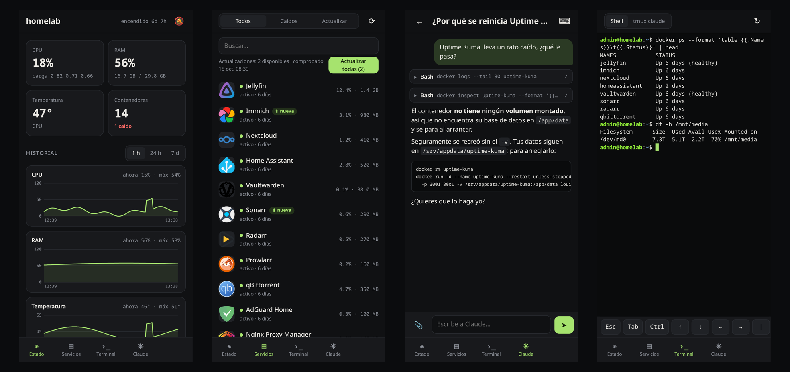
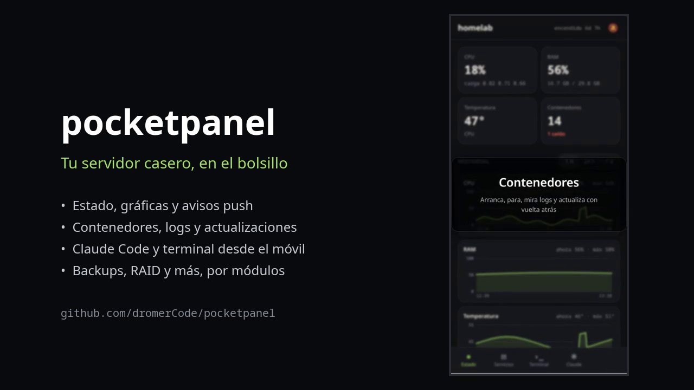
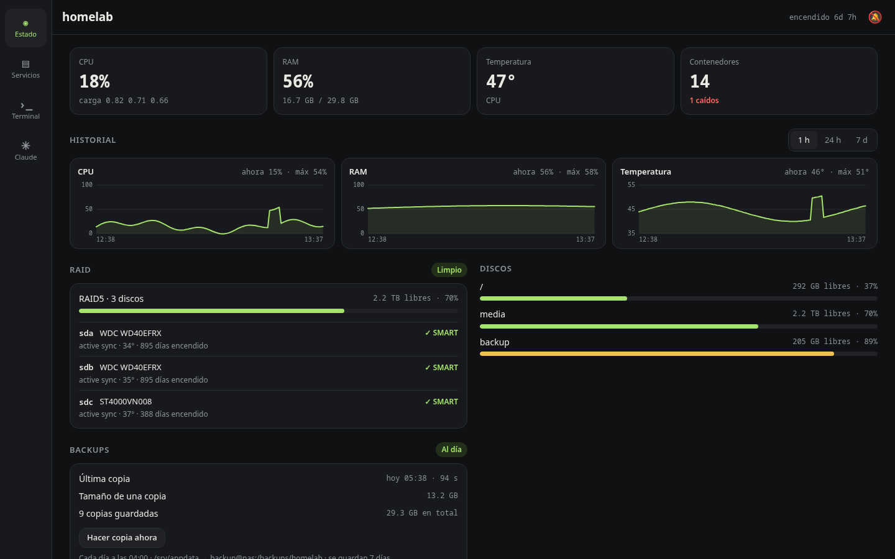
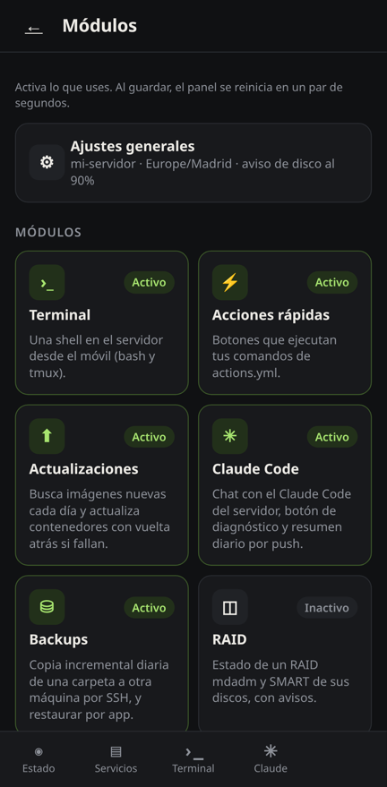

# pocketpanel

Your home server in your pocket: a small, self-hosted phone app (PWA) to keep an eye on a Linux + Docker
server and fix things from the couch. Lightweight (FastAPI + vanilla JS, one container), private by default
(listens only on `127.0.0.1`, meant to be reached over [Tailscale](https://tailscale.com)) and modular: turn on
only what you use.

> 🇪🇸 La interfaz está en español. [Instrucciones en español más abajo](#en-español).

<p align="center">
  
</p>

<p align="center">
  <a href="docs/screenshots/trailer.mp4"></a><br>
  <sub>▶ <a href="docs/screenshots/trailer.mp4">Watch the 30-second trailer</a> · screenshots use demo data</sub>
</p>

## Features

Always on:

- **Status**: CPU, RAM, temperature, disks, uptime and 1 h / 24 h / 7 d history charts.
- **Containers**: list, start / stop / restart, live logs, open button for each web UI.
- **Push alerts** (Web Push): a container stops, a disk fills up, a module reports a problem.
- PIN login with rate limiting, installable as an app on Android / iOS.

Optional modules, turned on and configured from the app itself (**Status → ⚙ Modules**):

| Module | What it does | Needs on the host |
|---|---|---|
| `terminal` (on) | Full terminal (bash, tmux) on the host over SSH | `tmux` for tmux mode |
| `actions` (on) | One-tap buttons that run your own commands (`actions.yml`) | – |
| `updates` (on) | Daily check for newer images, one-tap update with automatic rollback if the new container doesn't come up | – |
| `claude` | Chat with [Claude Code](https://claude.com/claude-code) running on the server, attach files, daily health report by push | `claude` installed and logged in |
| `backups` | Nightly incremental backups (rsync + hardlinks) of a folder to another machine over SSH, restore one app's folder from the container sheet | `rsync` on both ends |
| `raid` | mdadm RAID state + SMART (local or on another box over SSH) | `mdadm`, `smartctl` |
| `jellyfin` | Manage Jellyfin accounts and invites through [jfa-go](https://github.com/hrfee/jfa-go) | jfa-go |

On a wide screen it switches to a sidebar layout:



## Install (Ubuntu / Debian + Docker + Tailscale)

Requirements: Docker with the compose plugin (your user in the `docker` group), `openssh-server`, `python3`.

```sh
git clone https://github.com/dromerCode/pocketpanel.git ~/pocketpanel
cd ~/pocketpanel
./install.sh                 # run as your normal user, not root
```

The installer builds the image, creates an SSH key that the panel uses to reach the host (restricted to
`from="127.0.0.1"` in your `~/.ssh/authorized_keys`), writes `.env`, copies `config.yml` / `actions.yml` from
the examples and prints your PIN.

Then expose it to your tailnet with HTTPS (needed to install the app and for push notifications):

```sh
sudo tailscale serve --bg --https=8443 http://127.0.0.1:9300
```

and open `https://<server>.<your-tailnet>.ts.net:8443` on your phone → browser menu → *Install app*.

### Configure

Open **Status → ⚙** in the app: a "module store" where you switch modules on and off, fill in their options,
run a requirements check on the server (is `rsync` there? can it SSH into the backup box? is `claude` installed?)
and save. The panel rewrites `config.yml` (keeping your comments) and restarts itself in a couple of seconds.

<p align="center"></p>

You can still edit `config.yml` by hand (every option is commented) and apply with
`docker compose up -d --force-recreate`. Passwords entered in the app (jfa-go) are stored in `data/secrets.json`
(0600), not in `config.yml`. Change the PIN with `./install.sh NEWPIN`. Update with `git pull && ./install.sh`.

### Backups as root (optional)

By default backups and restores run as your user, so files only root can read are skipped (the panel tells
you which ones) and those backups can't be restored. To copy everything:

```sh
sudo ./install-root.sh        # again after changing modules.backups; --remove to undo
```

It copies `backup.sh` / `restore.sh` to `/etc/pocketpanel` (owned by root, source and destination fixed from your
config) and adds a sudoers rule that lets your user run **only those two scripts** as root.

## Security notes

- The backend binds to `127.0.0.1` with host networking: it is not reachable from your LAN, only through
  `tailscale serve` (or a reverse proxy you set up yourself).
- Anyone with the PIN gets a shell as your user and access to the Docker socket, which is root-equivalent.
  Use a long PIN and keep it on your tailnet.
- The panel's SSH key only works from `127.0.0.1`.

## Development

```sh
python -m venv .venv && .venv/bin/pip install -r requirements.txt pytest pytest-asyncio
.venv/bin/pytest
```

Backend in `app/` (`app/modules/` holds one file per optional module, registered only when enabled), frontend in
`web/` (no build step).

---

## En español

**pocketpanel** es una app para el móvil (PWA) con la que controlas tu servidor casero: estado, contenedores,
terminal, avisos push y, si quieres, Claude Code, backups, RAID y usuarios de Jellyfin. Va en un solo contenedor,
escucha solo en `127.0.0.1` y se abre desde el móvil por Tailscale.

### Instalación rápida

**Antes de empezar**, en el servidor necesitas:

```sh
sudo apt install openssh-server tmux rsync     # rsync solo si vas a usar backups
sudo usermod -aG docker $USER                  # y cierra sesión y vuelve a entrar
```

(Docker con el plugin de compose y Tailscale ya instalados y con sesión iniciada.)

**1. Instalar** (como tu usuario, no con sudo):

```sh
git clone https://github.com/dromerCode/pocketpanel.git ~/pocketpanel
cd ~/pocketpanel
./install.sh
```

Al final te enseña el **PIN**: apúntalo.

**2. Abrirlo desde el móvil por Tailscale:**

```sh
sudo tailscale serve --bg --https=8443 http://127.0.0.1:9300
```

En el móvil (conectado a tu tailnet) entra en `https://<nombre-del-servidor>.<tu-tailnet>.ts.net:8443`
(el nombre exacto sale con `tailscale status` o en el panel de Tailscale), mete el PIN y en el menú del
navegador dale a **"Instalar aplicación"** / "Añadir a pantalla de inicio". En Estado, la campanita 🔕 activa
los avisos push.

**3. Activar módulos** (opcional): en la app, **Estado → ⚙**. Es una "tienda" con todos los módulos (backups,
RAID, Claude, usuarios de Jellyfin…): tocas uno, lo activas, rellenas sus opciones, pulsas **Comprobar requisitos**
(mira en el servidor si tienes lo necesario) y **Guardar y reiniciar**. El panel se reinicia solo en un par de
segundos. En "Ajustes generales" cambias el nombre del servidor, los discos que se ven, etc.

**Con Claude Code** (si ya lo tienes instalado y con sesión iniciada en el servidor): actívalo en ⚙ y en
**Permisos** elige `auto` (o `bypassPermissions`); si no, el chat no puede ejecutar comandos. El HOME y la carpeta
de trabajo se detectan solos. Aparece la pestaña Claude (chat con adjuntos, botón de diagnóstico y resumen diario
por push) y el modo "tmux claude" en la terminal. Si instalaste `claude` con npm, pon su ruta en **Ruta de claude**
(la ves con `which claude`).

Si prefieres, todo sigue estando en `~/pocketpanel/config.yml` (comentado) para editarlo a mano y aplicar con
`docker compose up -d --force-recreate`. Los botones de acciones rápidas se editan en `actions.yml`.

**Otras cosas:**

- Cambiar el PIN: `./install.sh NUEVOPIN`
- Actualizar a la última versión: `git pull && ./install.sh`
- Si algo no va: `docker logs pocketpanel`
- Ojo: con el PIN se puede usar la terminal y Docker de tu servidor. No lo compartas y no lo expongas fuera de
  Tailscale.

## License

[MIT](LICENSE)
